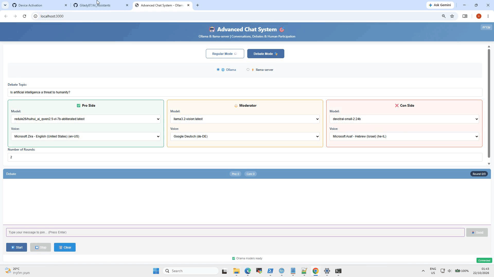
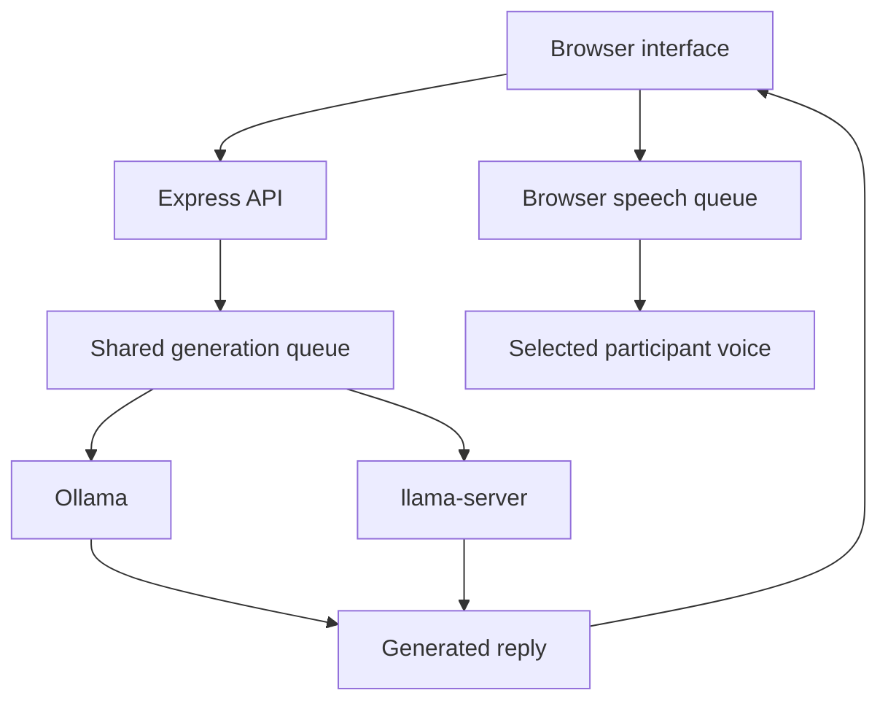

# ConversationAI

**Turn local language models into conversation partners, debate opponents, and a moderator—with queued voice playback and human participation.**

ConversationAI is a browser-based playground for exploring how local LLMs respond to each other. Run a two-participant conversation or a structured debate, choose voices for each role, and introduce your own messages while the session is running.

Built with Node.js, Express, vanilla JavaScript, and the browser's Web Speech API. The supplied server includes integrations for Ollama and llama.cpp's `llama-server`; see [Current implementation notes](#current-implementation-notes) for the current single-model llama-server setup.



## Features

| Feature | Description |
| --- | --- |
| Two-participant conversations | Alternate responses between two selected Ollama models for a configurable number of rounds. |
| Structured debates | Assign Pro, Con, and Moderator roles, with opening statements, rebuttal rounds, and a final judgment. |
| Human participation | Submit a message during a session; it is picked up at the next supported turn boundary. |
| Role-specific voices | Select a browser speech voice for each participant. |
| Queued audio | Play replies sequentially while generation can continue ahead of playback. |
| Playback status | See whether audio is playing and how many replies are waiting. |
| Session controls | Start, stop, and clear conversations; replay individual replies. |
| Local inference | Send generation requests to an Ollama or llama-server instance on your machine or network. |
| Sampling controls | The llama-server UI exposes temperature, top-p, top-k, repetition penalty, and maximum output tokens. |

## How it works



The application separates generation from speech playback:

- The server serializes `/api/generate` requests through a shared queue.
- The browser displays completed replies and queues their speech independently.
- An utterance's end or error event releases the next queued reply—there is no estimated-duration timer.
- A session remains active until its queued speech finishes. Stop cancels browser requests and clears browser speech playback.

## Quick start

### Requirements

- Node.js and npm.
- A running Ollama instance with at least one installed model for the working Ollama flow.
- A browser with speech synthesis support for read-aloud playback. Available voices depend on the browser and operating system.

### 1. Install dependencies

From the project directory:

```powershell
npm install
```

### 2. Configure the inference endpoint

Set the `OLLAMA_URL` environment variable to your Ollama instance:

```powershell
$env:OLLAMA_URL = "http://127.0.0.1:11434"
```

The supplied version points to a LAN address. Replace it with your own local or network endpoint. `OLLAMA_URL` supports an environment variable and defaults to `http://192.168.1.17:11434`.

For the server's llama-server integration, the default URL can be set through an environment variable:

```powershell
$env:LLAMA_SERVER_URL = "http://127.0.0.1:8080"
```

### 3. Start the application

```powershell
node enhanced_server_sync.js
```

Open **http://localhost:3000** in your browser.

To use another application port:

```powershell
$env:PORT = "3001"
node enhanced_server_sync.js
```

## Using the application

### Regular mode

1. Select **Ollama** as the backend.
2. Choose the two models and their voices. You can use the same model for both participants.
3. Set a topic and number of rounds.
4. Start the conversation. Each round contains one response from each participant.
5. Optionally submit a message to redirect the next turn.

Each model receives the previous reply as its next prompt. This is turn-by-turn prompting rather than a full persistent chat-history implementation.

### Debate mode

Choose a topic, models, and voices for three roles:

| Role | Responsibility |
| --- | --- |
| Pro | Argue in favor of the topic and respond to the opposing side. |
| Con | Argue against the topic and respond to the Pro side. |
| Moderator | Open the debate, address audience input, and deliver a final judgment. |

The debate includes opening statements followed by the configured rebuttal rounds. At the end, the moderator receives the debate transcript, including opening statements, rebuttals, and audience exchanges, and is prompted to score both sides out of ten. Scores are displayed when the reply matches the expected `Pro: X/10, Con: Y/10` format.

The scores are model-generated judgments, not an objective benchmark.

### Voice playback

Replies are automatically added to the browser speech queue. Each queued item retains the voice selected when it was added, so changing a selector does not change replies already waiting.

Use a reply's read-aloud button to queue it again. The separate **Open in Edge** action launches a speech page through the server and is outside the main browser playback queue.

## Configuration

| Setting | Location | Behavior |
| --- | --- | --- |
| `PORT` | Environment variable | Application port; defaults to `3000`. |
| `OLLAMA_URL` | Environment variable | Base URL used for model discovery and Ollama generation. |
| `LLAMA_SERVER_URL` | Environment variable | Default llama-server URL; the supplied fallback is a LAN address. |
| `MODELS_DIR` | Environment variable | Directory recursively scanned for `.gguf` files; defaults to `/home/llama.cpp/build/bin/models` on the Node.js host. |
| Server URL | Browser interface | URL used by the llama-server connection check and the UI's generation request. The current setup uses one loaded model at a time. |

Environment variables can be set in PowerShell before starting Node. The supplied server does not load `.env` files itself.

## API reference

| Method | Endpoint | Purpose |
| --- | --- | --- |
| `GET` | `/api/models` | Return available Ollama model names. |
| `GET` | `/api/local-models` | Discover `.gguf` files beneath `MODELS_DIR`. |
| `GET` | `/api/llama-server/health?url=...` | Check readiness through the target server's `/health` endpoint. |
| `GET` | `/api/llama-server/models?url=...` | Discover loaded models through the remote server's `/v1/models`. |
| `POST` | `/api/generate` | Queue generation using the requested backend, model, prompt, and optional parameters. |
| `POST` | `/api/speak-with-edge` | Launch a separate speech page on the machine running Node.js. |

Example generation request:

```json
{
  "backend": "ollama",
  "model": "YOUR_INSTALLED_MODEL",
  "prompt": "Start a short conversation about local AI.",
  "params": {
    "temperature": 0.7,
    "max_tokens": 256
  }
}
```

For the server's llama-server adapter, use `"backend": "llama"` and optionally supply `serverUrl`. The adapter calls `/v1/chat/completions` and uses the model already loaded by that server.

## Project structure

| Path | Purpose |
| --- | --- |
| `enhanced_server_sync.js` | Express server, generation queue, inference adapters, and API routes. |
| `public/index.html` | Browser interface, conversation and debate flows, and speech queue. |
| `package.json` | Project metadata and dependencies. |
| `package-lock.json` | Dependency lockfile. |
| `run.bat` | Windows launcher included with the project. |
| `Pics/` | Local screenshot and demo preparation assets. |

Run Node from the project root so relative paths resolve as intended. The server chooses a static directory containing `index.html`, checking the launch directory before `public/`.

## Current implementation notes

- **One model at a time with llama.cpp:** The current integration connects to a single `llama-server` instance with one GGUF model loaded at a time. Both conversation participants, and the Pro, Con, and Moderator roles in debate mode, use that same loaded model, with different prompts and optional voices. The model selectors do not load separate models for each participant.
- **Changing the llama.cpp model:** Stop and restart `llama-server` with a different `-m /path/to/model.gguf`, then click **Check Connection** in the UI to refresh the available model. The application does not load or switch GGUF files itself. This describes the current application setup, rather than a general limitation of llama.cpp.
- **llama-server requests:** The UI discovers the loaded model through `/api/llama-server/models` and sends generation to `/api/generate` with `backend: "llama"`. The adapter uses `/v1/chat/completions` with instructions to produce one short turn.
- **Ollama requests:** The UI explicitly selects `backend: "ollama"` for Ollama generation.
- **Stopping generation:** Stop aborts the browser request and discards stale replies, but does not explicitly cancel inference already running on the backend.
- **Persistence:** The supplied conversation flow keeps its visible transcript in the page; it does not implement persistent session storage or transcript export.
- **Socket.IO:** The server provides a connection greeting hook. Generation replies are delivered through HTTP, rather than streamed over Socket.IO.

## Troubleshooting

| Symptom | What to check |
| --- | --- |
| No Ollama models appear | Verify `OLLAMA_URL`, connectivity from the Node.js host, and installed Ollama models. |
| llama-server generation returns 404 | Verify the server URL, restart the app after updates, and check that llama-server exposes /v1/chat/completions. |
| Unexpected backend handles a request | Send an explicit `backend` value to `/api/generate`. |
| No speech or missing voices | Check browser speech synthesis support and the voices available on the operating system. |
| Edge does not open | The launcher runs on the Node.js host; on Windows, `msedge` must be resolvable. |
| No GGUF files are listed | Verify `MODELS_DIR`; its default is `/home/llama.cpp/build/bin/models` on the Node.js host. Remote models are discovered through llama-server. |
| Port is already in use | Set a different `PORT` value before launching the server. |
